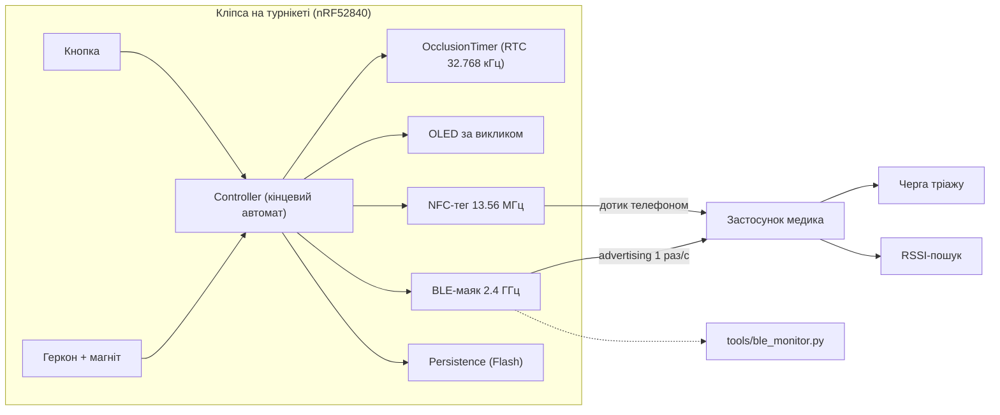
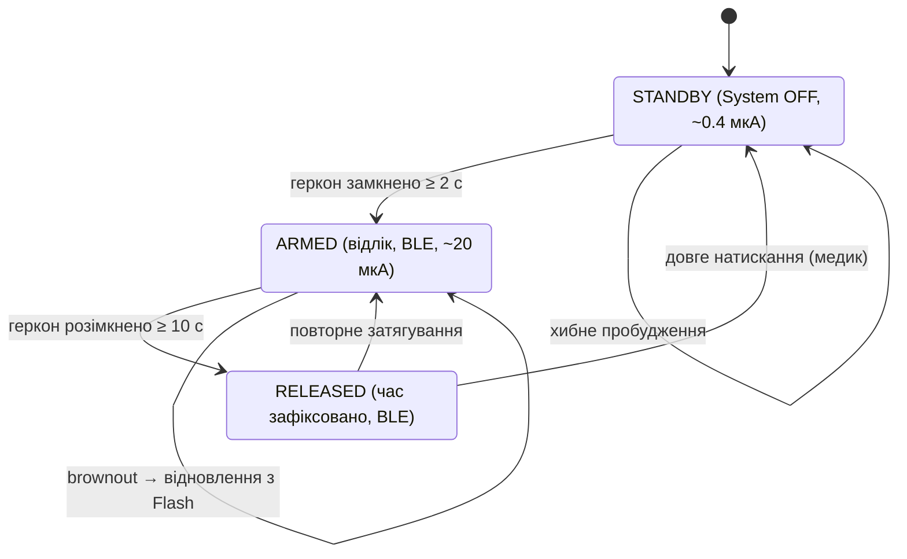

# Архітектура системи

## 1. Компоненти

## 2. Стани прошивки

## 3. Шари прошивки

| Шар | Каталог | Може залежати від | Приклад |
|-----|---------|-------------------|---------|
| Застосунок | `src/app/` | усього нижче | `Controller` |
| Сервіси | `src/services/` | `core`, Arduino/SoftDevice | `BleBeacon`, `OcclusionTimer` |
| Драйвери | `src/drivers/` | `core`, Arduino | `ReedSwitch`, `OledDisplay` |
| Ядро | `src/core/` | нічого (чистий C++) | `Triage`, `BeaconPacket` |

## 4. Шари застосунку

| Шар | Каталог | Відповідальність |
|-----|---------|------------------|
| core | `lib/core/` | константи, моделі, форматування |
| data | `lib/data/` | BLE / NFC → моделі |
| domain | `lib/domain/` | сортування, RSSI-аналітика |
| ui | `lib/ui/` | екрани, віджети |

## 5. Ключові проєктні рішення

| Рішення | Обґрунтування |
|---------|---------------|
| nRF52840 замість ESP32 | Пік TX ~5 мА проти 150–250 мА; сон 1–2 мкА. CR2032 не тягне ESP32 (brownout). |
| Advertising без з'єднання | Нуль дій від медика; один телефон бачить усіх поранених одночасно. |
| Відлік у System ON idle, а не System OFF | У System OFF RTC зупиняється — час втрачався б. |
| Довгі інтервали антибрязкоту геркона | Транспортування пораненого не повинно скидати/зупиняти таймер. |
| Застосунок рахує `appliedAt`, а не лише показує `elapsed` | Час продовжує йти на телефоні при втраті сигналу (РЕБ). |
| Резервна копія у Flash | Brownout CR2032 не обнуляє час оклюзії. |
| Відмова від LoRa на кліпсі | Демаскування для РЕР, антена, споживання. LoRa — лише шлюз на евакуаційному транспорті. |
